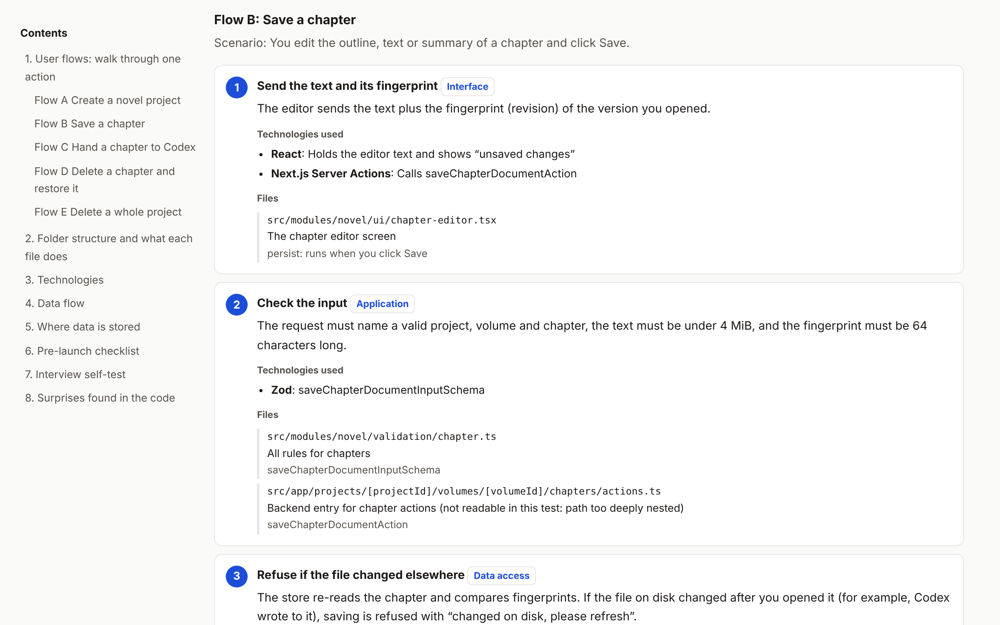
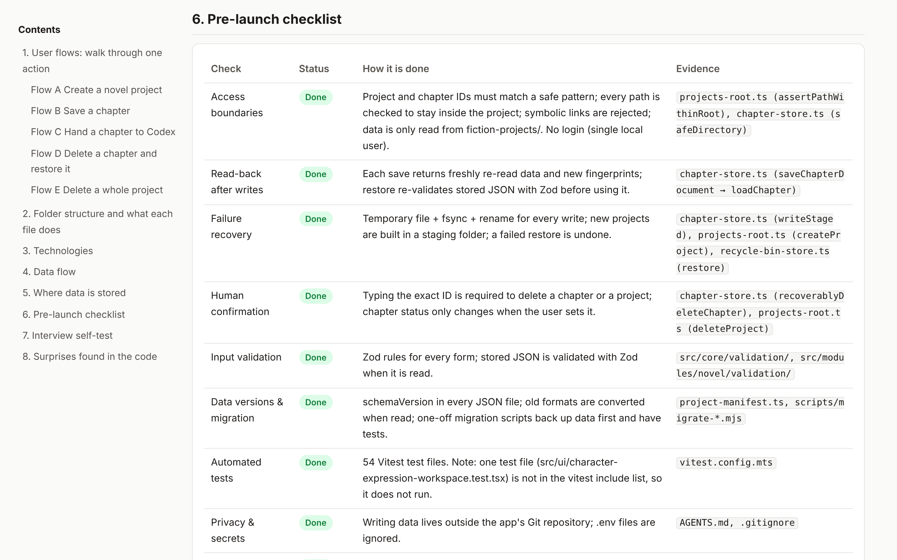

# The Last Mile: PM to Code

**English** | [中文](README.zh-CN.md)

> **You shipped it with AI. Now own it.**

AI can build your app in an afternoon. It cannot explain that app to your boss, your engineers or your interviewer. That last mile is yours, and this skill walks it with you.

Point it at any vibe-coded project and get a **guided tour of your own code**, written for people who have never written a line of it. Where the data lives, what every file is for, what happens when you click each button, and what still stands between you and launch.

**Stop nodding along when engineers talk. Start explaining your product all the way down to the code.**



## Why this exists

Vibe coding created a new kind of builder: people who can ship real software but can't defend it.

- *"Where is the data stored?"* You're not sure.
- *"What happens if two people save at once?"* You hope nothing bad.
- *"What's missing before launch?"* No idea where to look.

This skill closes that gap. It reads every line so you don't have to, then hands you the answers in plain words, with proof.

## What you get

**One beautiful, self-contained HTML report.** No server, no setup. Just open it.

| Section | What it gives you |
|---|---|
| **User flows** | Every key action, traced click by click from the button to the file on disk: technology, file and function at each step |
| **Folder map** | Every file labelled with its layer and its job. Your codebase finally makes sense |
| **Tech stack, decoded** | A layered architecture diagram, plus every technology explained with an everyday comparison |
| **Data flow diagram** | See your whole system in one picture |
| **Where data lives, and why** | The design decisions behind your storage, in one table |
| **12-point launch checklist** | Access boundaries, failure recovery, validation, tests, backups, audit trail. Each one *Done*, *Partial* or *Not done*, with evidence |
| **Interview self-test** | The exact questions an interviewer will ask, with answers hidden until you're ready |
| **Surprises in your code** | Contradictions and blind spots you never knew were there |



## It finds things you didn't know

Real catches from its first runs:

- **The docs were lying.** The README promised deleted projects go to a trash folder. The code deletes them forever.
- **A test that never ran.** It existed in the repo but was left out of the test config, so it gave a false sense of safety.
- **A hidden feature.** A working export function with no button anywhere in the app.

**No guessing, no hand-waving:** every statement in the report points to a real file and function. All 23 function references in the test report were verified against the code.

## Examples

| Project | Report | Language |
|---|---|---|
| Fiction Workbench: a local workspace for long novels (Next.js, Markdown + JSON files) | [examples/fiction-workbench.html](examples/fiction-workbench.html) | English |
| Short Story Expander: a local short-story tool (Next.js, SQLite) | [examples/short-story-expander.zh.html](examples/short-story-expander.zh.html) | 中文 |

Download an example and open it in your browser to see the full experience.

## How to use

1. Copy this folder into your agent's skills folder:
   - Claude Code: `~/.claude/skills/last-mile-pm-to-code/`
   - Codex: `.agents/skills/last-mile-pm-to-code/` in your project
2. Open your project and say: *"Help me understand this project."*
3. Pick a language: English (default) or 中文.
4. Read your report, then take the quiz the agent gives you. **No peeking.**

Requirements: Python 3. Diagrams render offline if the [Mermaid CLI](https://github.com/mermaid-js/mermaid-cli) (`mmdc`) is installed; otherwise they render in the browser.

## Built on five principles

1. **The code is the truth.** Docs can be outdated; code can't. When they disagree, the report says so.
2. **Proof for every claim.** Every statement points to a file and a function.
3. **No hype in the report.** Unbuilt features are marked "Not done". Nothing is invented.
4. **Just deep enough.** Technology, file and function, with no line-by-line lectures.
5. **Plain words.** Every technology comes with an everyday comparison.

## What's inside

```
SKILL.md                    The rules and steps your agent follows
checklist.md                The launch checklist; add your own checks anytime
references/report-spec.md   The data format behind every report
scripts/build_report.py     Turns that data into the HTML report
examples/                   Two finished reports and one data file
```

## The story behind it

I built several working apps with AI and couldn't explain how any of them worked. Code-review tools already find bugs; nothing helped me *understand*. So I built this, one decision at a time:

- **From map to journey.** My first report was a map, and I still couldn't read it. Walking through one real click at a time made it click.
- **From trust to proof.** Early on, the AI wrote one step from the docs instead of the code, and got it wrong. That became the first rule: the code is the truth.
- **Built to grow.** The checklist lives in its own file, so every new interview question makes the skill sharper.

## Testing

- Tested on two projects with completely different architectures: one built on a SQLite database, the other on pure Markdown and JSON files with Zod validation.
- Every function name in the report was verified against the code.
- Every report was checked at desktop and phone width, in light and dark mode.
- Learning is measured, not assumed: three questions answered from memory before using the report, recorded as a baseline.

## Good to know

- Built for understanding and communication, not as a security audit.
- If a file can't be read, the report says so instead of guessing.
