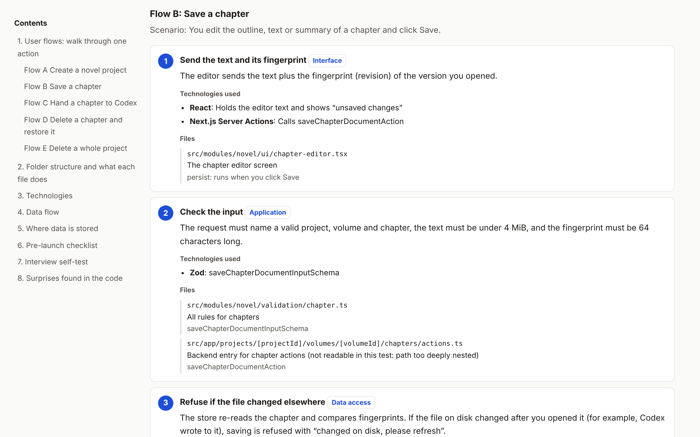

# The Last Mile: PM to Code（最后一公里：从产品到代码）

[English](README.md) | **中文**

> **用 AI 做出来了，现在让它真正属于你。**

AI 一个下午就能帮你做出一个应用，却没办法替你向老板、工程师或面试官讲清楚它。这最后一公里得你自己走，这个技能陪你走完。

把它对准任何一个 Vibe Coding 项目，你就能得到一份**你自己代码的导览手册**，专门写给一行代码都没写过的人：数据存在哪、每个文件干什么、点下每个按钮后发生了什么，以及离上线还差什么。

**别再在技术讨论里只会点头。从产品一路讲到代码，你也可以。**



## 为什么要做这个

Vibe Coding 造就了一群新的创造者：能做出真正可用的软件，却说不清它是怎么运作的。

- “数据存在哪？”你不确定。
- “两个人同时保存会怎样？”你只能希望别出事。
- “离上线还差什么？”你不知道从哪里看起。

这个技能替你读完每一行代码，再用大白话把答案交给你，而且每个答案都有证据。

## 你会得到什么

**一份精美、独立的 HTML 报告**，不需要服务器，也不需要配置，打开就能看。

| 部分 | 帮你解决什么 |
|---|---|
| **操作流程** | 每个关键操作从按钮一路追到磁盘上的文件，每一步写清楚技术、文件和函数 |
| **文件地图** | 每个文件都标出属于哪一层、负责什么，代码库终于看得懂了 |
| **技术栈拆解** | 一张分层架构图，每个技术都配一个生活里的比方 |
| **数据流向图** | 整个系统，一张图看完 |
| **数据存在哪里，为什么** | 一张表看懂存储设计背后的决定 |
| **12 项上线检查** | 权限边界、失败恢复、输入校验、测试、备份、审计，逐项标出已实现、部分或未实现，并附证据 |
| **面试自测** | 面试官真的会问的问题，答案先藏起来，等你准备好再看 |
| **代码里的意外** | 你从来不知道的矛盾和盲点 |

## 它会发现你不知道的事

前几次真实运行时抓到的问题：

- **文档在说谎**：README 写着删除的项目会进回收站，代码其实是永久删除。
- **从没跑过的测试**：测试文件明明在仓库里，却没写进测试配置，让人误以为这部分是安全的。
- **隐藏的功能**：一个能用的导出功能，应用里却找不到任何按钮。

**不靠猜，不糊弄**：报告里每一句话都能指到真实的文件和函数。测试报告中的 23 个函数引用，全部和代码核对过。

## 示例

| 项目 | 报告 | 语言 |
|---|---|---|
| Fiction Workbench：本地长篇小说工作台（Next.js，Markdown + JSON 文件） | [examples/fiction-workbench.html](examples/fiction-workbench.html) | 英文 |
| Short Story Expander：本地短篇小说工具（Next.js，SQLite） | [examples/short-story-expander.zh.html](examples/short-story-expander.zh.html) | 中文 |

下载示例文件，用浏览器打开，就能看到完整效果。

## 怎么用

1. 把这个文件夹复制到 Agent 的技能目录：
   - Claude Code：`~/.claude/skills/last-mile-pm-to-code/`
   - Codex：项目里的 `.agents/skills/last-mile-pm-to-code/`
2. 打开你的项目，对 Agent 说：“帮我看懂这个项目。”
3. 选择语言：英文（默认）或中文。
4. 读完报告后，完成 Agent 给你的小测验。**不许偷看。**

运行需要 Python 3。如果装了 [Mermaid CLI](https://github.com/mermaid-js/mermaid-cli)（`mmdc`），图会离线渲染；没装的话，会在浏览器里渲染。

## 五条原则

1. **代码说了算**：文档可能过时，代码不会。两者对不上时，报告会直接指出来。
2. **每句话都有证据**：每个结论都指到具体的文件和函数。
3. **报告里不吹牛**：没做的功能就标“未实现”，什么都不编。
4. **深度刚刚好**：讲到技术、文件和函数为止，不逐行说教。
5. **说人话**：每个技术都配一个生活里的比方。

## 文件说明

```
SKILL.md                    Agent 遵循的规则和步骤
checklist.md                上线检查清单，随时可以加新的检查项
references/report-spec.md   每份报告背后的数据格式
scripts/build_report.py     把数据变成 HTML 报告
examples/                   两份完整报告和一个数据文件
```

## 背后的故事

我用 AI 做出了好几个能用的应用，却一个都讲不清它们是怎么运作的。找 bug 的工具已经很多，但没有一个能帮我看懂。所以我自己做了这个，一个决定接一个决定：

- **从地图到旅程**：第一版报告像一张地图，我还是看不懂。改成跟着一次真实的点击走一遍，才终于看懂。
- **从相信到求证**：早期 AI 有一步照着文档写，没看代码，结果写错了。这成了第一条规则：代码说了算。
- **越用越强**：检查清单单独放在一个文件里，每学到一个新的面试问题，技能就更强一点。

## 测试

- 在两个架构完全不同的项目上测过：一个基于 SQLite 数据库，另一个只用 Markdown 和 JSON 文件，并用 Zod 做校验。
- 报告里的每个函数名都和代码核对过。
- 每份报告都在电脑和手机宽度、浅色和深色模式下检查过。
- 学习效果靠测，不靠想：用报告之前，先凭记忆回答 3 道题，结果记为基线。

## 说明

- 用来理解和沟通，不是安全审计。
- 遇到读不到的文件，报告会如实写明，不会瞎猜。
